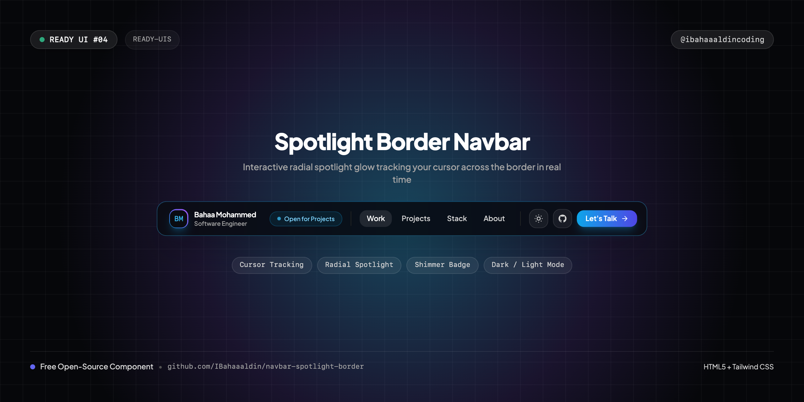
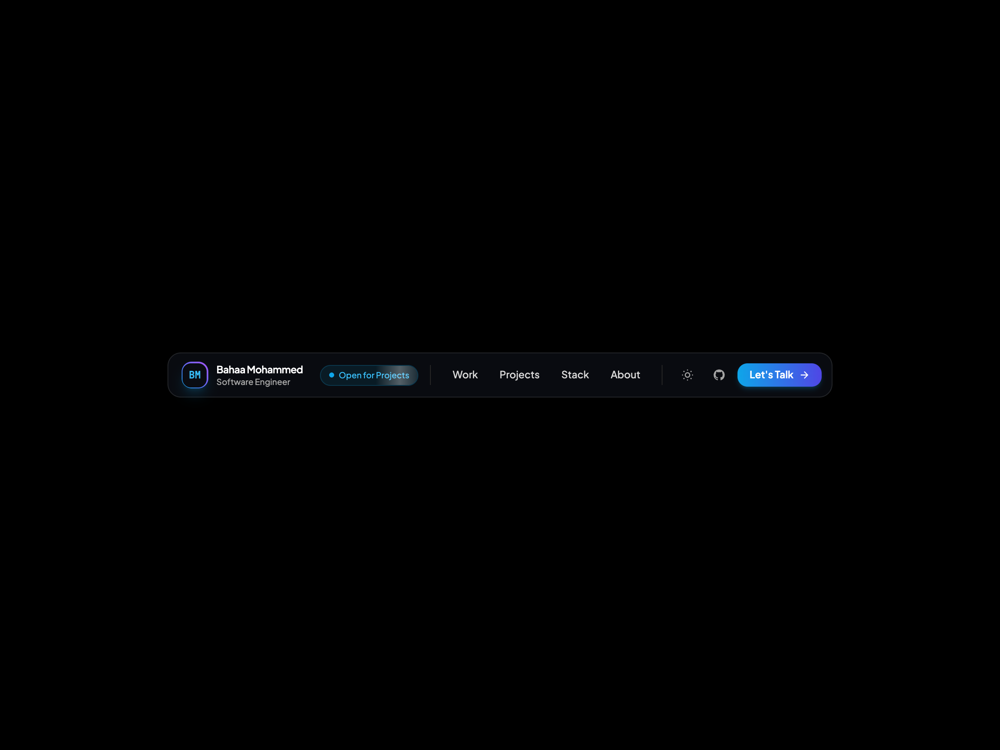
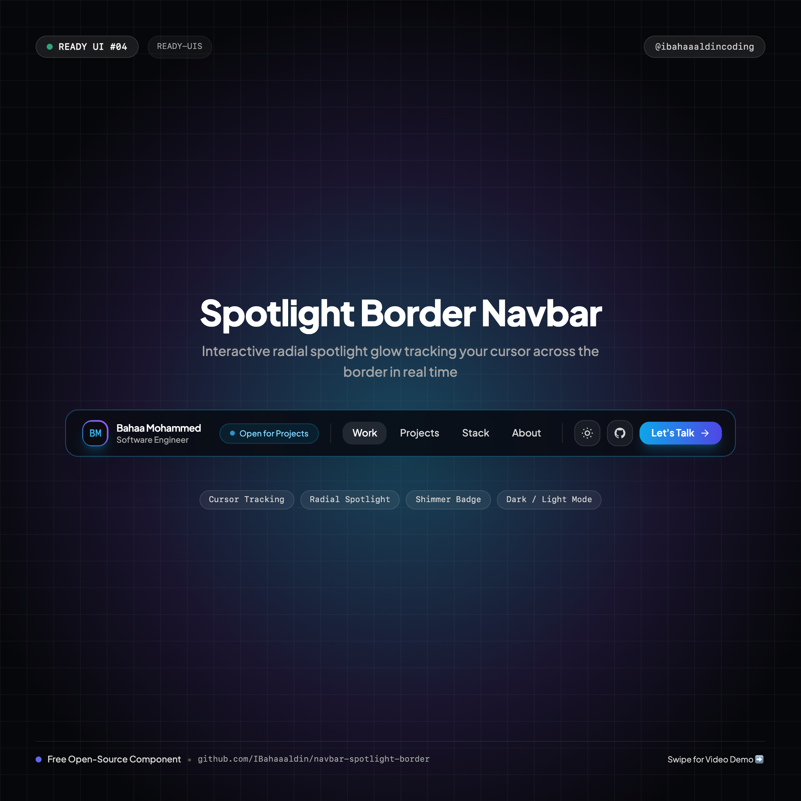

# 🔦 Spotlight Border Navbar

> An ultra-sleek, Raycast & Stripe-inspired floating navbar on a minimal canvas featuring real-time interactive cursor spotlight glow, animated shimmer badge, and dark/light mode.



[](https://IBahaaaldin.github.io/navbar-spotlight-border/)
[](https://IBahaaaldin.github.io/navbar-spotlight-border/)

---

## 🌐 Visual Previews

| Desktop Showcase (1200x900) | Mobile Showcase (390x844) | Instagram Cover (1080x1080) |
| :---: | :---: | :---: |
|  |  |  |

*(Includes full interaction videos: `video-desktop.mp4` and `video-mobile.mp4`)*

---

## ✨ Features & Micro-Interactions

- **Interactive Cursor Spotlight**: A dynamic radial gradient spotlight tracks your mouse position in real-time, casting a luminous chromatic cyan/purple glow across the outer border and glass surface.
- **Animated Shimmer Badge**: High-contrast "Open for Projects ✨" badge with a continuous light reflection beam.
- **Top-Anchored Ergonomics**: Anchored gracefully at `top-4` on mobile and `top-6` on desktop. Never jumps into awkward screen positions when resizing.
- **Mobile Spotlight Drawer**: Expanding reveals clean numbered project rows (`01 Selected Work`, `02 Projects`, `03 Stack`, `04 About`), social links, and gradient CTA.
- **Strict Single-Line Text**: All typography styled with `whitespace-nowrap` to prevent awkward line wrapping.
- **One-Click Theme Switcher**: Sun ☀️ / Moon 🌙 button seamlessly flipping the entire page between pure black (`#000000`) and pure white (`#ffffff`).
- **Zero Build Step**: 100% self-contained HTML5 + Tailwind CSS CDN + inline SVGs.

---

## 📁 Repository Structure

```text
├── index.html              # Standalone production navbar component
├── cover.png               # Widescreen cover banner (1280x640)
├── cover-instagram.png     # Square cover for Instagram (@ibahaaaldincoding) (1080x1080)
├── screenshot-desktop.png  # Desktop visual preview (1200x900)
├── video-desktop.mp4       # Desktop interaction recording (MP4)
├── screenshot-mobile.png   # Mobile visual preview (390x844)
├── video-mobile.mp4        # Mobile interaction recording (MP4)
├── record.js               # Playwright automation script used to record all 4 assets
├── README.md               # Documentation & setup notes
└── CAPTION.md              # Ready-to-copy Instagram caption for @ibahaaaldincoding
```

---

## 🚀 Quick Start

### 1. View Locally
Simply open `index.html` in your browser:
```bash
open index.html
```

### 2. Cursor Spotlight
Move your cursor across the navbar to observe the real-time dynamic spotlight border glow.

---

## 📬 Connect

- **Instagram**: [@ibahaaaldincoding](https://www.instagram.com/ibahaaaldincoding)
- **GitHub**: [@IBahaaaldin](https://github.com/IBahaaaldin)
- **LinkedIn**: [Bahaa Mohammed](https://www.linkedin.com/in/bahaa-mohammed-371259369)
- **Email**: bahaam.coding@gmail.com
